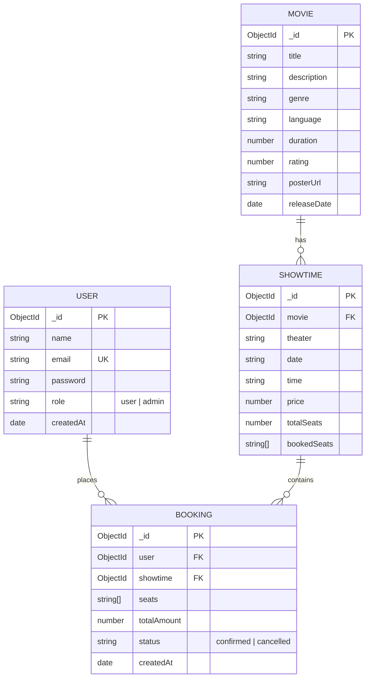

# 🎬 IMovies - Movie Ticket Booking Web Application

[](https://reactjs.org/)
[](https://opensource.org/licenses/MIT)
[](https://nodejs.org/)

**IMovies** is a full-stack MERN (MongoDB, Express.js, React.js, Node.js) web application designed for browsing movies, viewing scheduled showtimes, selecting seats in real-time, and booking tickets online. It includes full role-based access control (User and Admin), authentication via JWT and bcryptjs, real-time seat conflict validation, booking cancellation with seat release, and an administrative management dashboard.

Developed as a **BTech Computer Science Final Course Project** adhering to clean, beginner-readable code, MVC architecture, and strict separation of concerns.

---

## 📌 Features

### 👤 User Features
- **User Authentication:** Secure registration and login using JWT (JSON Web Tokens) and bcrypt password hashing.
- **Movie Catalog:** Browse now-showing movies in a responsive card grid with title search and genre filtering.
- **Movie Details:** Comprehensive movie synopsis, poster image, rating, duration, release date, and upcoming showtimes.
- **Interactive Seat Selection:** Real-time visual theater seat map (Rows A–D, 40 total seats) showing:
  - ⚪ **Available seats**
  - 🟢 **Selected seats** (with live quantity & price tally)
  - ⚫ **Booked/Disabled seats**
- **Real-Time Booking Conflict Protection:** Server rejects bookings if any requested seat is already booked, preventing race conditions.
- **Booking Management:** View booking history under "My Bookings" with badges and date details.
- **Booking Cancellation:** Users can cancel their own confirmed reservations, instantly releasing the booked seats back to the theater.

### 🛡️ Admin Features
- **Admin Dashboard:** Central control panel restricted to accounts with `role: "admin"`.
- **Movie Management:** Add new movies, edit existing movie details (title, genre, language, duration, rating, poster URL), or delete movies (which automatically cascades to remove associated showtimes).
- **Showtime Scheduling:** Schedule new showtimes for any movie with theater selection, date, time, and ticket pricing.
- **Global Booking Audit:** Inspect all customer reservations across the platform with customer names, emails, seat labels, amounts, and statuses.

---

## 🛠️ Technology Stack

| Layer | Technology | Description |
| :--- | :--- | :--- |
| **Frontend** | React.js (Vite) | Fast component-based user interface |
| **Routing** | React Router v6 | Client-side routing and route protection |
| **Styling** | Bootstrap 5 + React-Bootstrap | Responsive layout, modals, navbars, cards |
| **HTTP Client** | Axios | REST API communication with JWT interceptor |
| **Backend** | Node.js + Express.js | RESTful API built on MVC pattern |
| **Database** | MongoDB + Mongoose | NoSQL document database with strict schema modeling |
| **Security** | JWT + bcryptjs | Stateless token auth & cryptographic password hashing |
| **Environment** | dotenv | Secure environment variable configuration |

---

## 🏛️ System Architecture

### Text Architecture Diagram
```
+-----------------------------------------------------------------------+
|                            CLIENT TIER                                |
|                        React.js 18 + Vite                             |
|                                                                       |
|   [ Home ]       [ Movie Details ]      [ Seat Map ]    [ My Bookings]|
|   [ Login ]      [ Register ]           [ Admin Dashboard ]           |
|                                                                       |
|                     Axios HTTP Client + Interceptor                   |
+-----------------------------------▲-----------------------------------+
                                    │ HTTP / JSON (Bearer JWT)
+-----------------------------------▼-----------------------------------+
|                            SERVER TIER                                |
|                        Node.js + Express.js                           |
|                                                                       |
|   Routes:                                                             |
|     /api/auth       -> authController.js     (Register, Login, Me)    |
|     /api/movies     -> movieController.js    (CRUD + Filters)         |
|     /api/showtimes  -> showtimeController.js (Schedule, Fetch)        |
|     /api/bookings   -> bookingController.js  (Book, Cancel, Audit)    |
|                                                                       |
|   Middleware:                                                         |
|     auth.js         (JWT token validation & user attachment)          |
|     adminOnly.js    (Role-based access verification)                  |
+-----------------------------------▲-----------------------------------+
                                    │ Mongoose ODM
+-----------------------------------▼-----------------------------------+
|                           DATABASE TIER                               |
|                       MongoDB (Local / Atlas)                         |
|                                                                       |
|   Collections:                                                        |
|     - users       (name, email, password, role)                       |
|     - movies      (title, genre, language, duration, poster, rating)  |
|     - showtimes   (movieRef, theater, date, time, price, bookedSeats) |
|     - bookings    (userRef, showtimeRef, seats, totalAmount, status)  |
+-----------------------------------------------------------------------+
```

---

## 📊 Database Models & ER Diagram



---

## 🔄 User & Admin Flows

### 1. User Journey
1. **Browse:** Visitor explores the home page, searches by movie title or filters by genre.
2. **Details:** Visitor clicks on a movie card to read the synopsis, runtime, and view scheduled dates/times.
3. **Seat Selection:** User picks an upcoming showtime and clicks **Select Seats** to view the interactive 40-seat grid.
4. **Authentication:** User selects seats and clicks **Confirm Booking**. If not logged in, they are redirected to login/register and returned seamlessly.
5. **Real-time Confirmation:** The server verifies that none of the chosen seats were reserved in the interim. Upon confirmation, tickets are booked and seats marked reserved.
6. **Cancellation:** User visits **My Bookings** and can cancel any reservation; the server marks the booking cancelled and releases those seats back to the theater.

### 2. Admin Journey
1. **Sign In:** Administrator logs in using administrative credentials (`role: "admin"`).
2. **Dashboard Access:** The **Admin Dashboard** navigation link becomes visible.
3. **Movie Management:** Admin can add new movies, edit descriptions/ratings/posters, or remove movies.
4. **Showtime Scheduling:** Admin links upcoming dates and times to any active movie with theater name, ticket price, and seat capacity.
5. **System Audit:** Admin monitors all user bookings, financial totals, and reservation statuses in real-time.

---

## 📂 Project Folder Structure

```
imovies/
├── backend/
│   ├── config/
│   │   └── db.js                 # MongoDB connection logic
│   ├── controllers/
│   │   ├── authController.js     # User registration, login, profile
│   │   ├── movieController.js    # Movie CRUD & search queries
│   │   ├── showtimeController.js # Showtime queries & admin creation
│   │   └── bookingController.js  # Booking, seat locks, cancellation
│   ├── middleware/
│   │   ├── auth.js               # JWT verification middleware
│   │   └── adminOnly.js          # Admin role guard middleware
│   ├── models/
│   │   ├── User.js               # User schema with pre-save hash
│   │   ├── Movie.js              # Movie catalog schema
│   │   ├── Showtime.js           # Showtime & bookedSeats schema
│   │   └── Booking.js            # Customer booking schema
│   ├── routes/
│   │   ├── authRoutes.js         # /api/auth routes
│   │   ├── movieRoutes.js        # /api/movies routes
│   │   ├── showtimeRoutes.js     # /api/showtimes routes
│   │   └── bookingRoutes.js      # /api/bookings routes
│   ├── .env                      # Local environment configuration
│   ├── .env.example              # Template environment variables
│   ├── package.json              # Backend dependencies and scripts
│   ├── seed.js                   # Database seeder (Admin, User, Movies, Showtimes)
│   ├── server.js                 # Express server entry point
│   ├── test-api.js               # Automated 23-endpoint API test suite
│   └── test-edge-cases.js        # Double-booking & security test suite
├── frontend/
│   ├── public/                   # Static public assets
│   ├── src/
│   │   ├── api/
│   │   │   └── axios.js          # Axios client with JWT header interceptor
│   │   ├── components/
│   │   │   ├── LoadingSpinner.jsx# Reusable loading spinner
│   │   │   ├── Navbar.jsx        # Responsive navigation header
│   │   │   └── ProtectedRoute.jsx# Auth & Admin route guards
│   │   ├── context/
│   │   │   └── AuthContext.jsx   # Global authentication state
│   │   ├── pages/
│   │   │   ├── AdminDashboard.jsx# Admin movies, showtimes & bookings
│   │   │   ├── Home.jsx          # Movie catalog with search & genre filter
│   │   │   ├── Login.jsx         # Sign-in form with quick-fill demo buttons
│   │   │   ├── MovieDetails.jsx  # Movie synopsis and showtime listings
│   │   │   ├── MyBookings.jsx    # User reservations & cancellation
│   │   │   ├── Register.jsx      # Account creation form
│   │   │   └── SeatSelection.jsx # 40-seat interactive cinema grid
│   │   ├── App.jsx               # Application routing and footer
│   │   ├── index.css             # Custom cinema styles & seat legend
│   │   └── main.jsx              # Vite React entry point
│   ├── index.html                # HTML template
│   ├── package.json              # Frontend dependencies and scripts
│   └── vite.config.js            # Vite build configuration
├── .gitignore                    # Excludes node_modules, .env, build files
└── README.md                     # Comprehensive project documentation
```

---

## 🔌 API Endpoints Reference

Base URL: `http://localhost:5000/api`

### 1. Authentication (`/api/auth`)
| Method | Endpoint | Access | Description |
| :--- | :--- | :--- | :--- |
| `POST` | `/api/auth/register` | Public | Register new user account |
| `POST` | `/api/auth/login` | Public | Authenticate user & return JWT |
| `GET` | `/api/auth/me` | Private | Get current authenticated user profile |

### 2. Movies (`/api/movies`)
| Method | Endpoint | Access | Description |
| :--- | :--- | :--- | :--- |
| `GET` | `/api/movies` | Public | List movies (supports `?search=` and `?genre=`) |
| `GET` | `/api/movies/:id` | Public | Retrieve single movie details |
| `GET` | `/api/movies/:id/showtimes` | Public | List all upcoming showtimes for movie |
| `POST` | `/api/movies` | Admin | Create a new movie |
| `PUT` | `/api/movies/:id` | Admin | Update movie details |
| `DELETE` | `/api/movies/:id` | Admin | Delete movie and remove its showtimes |

### 3. Showtimes (`/api/showtimes`)
| Method | Endpoint | Access | Description |
| :--- | :--- | :--- | :--- |
| `GET` | `/api/showtimes/:id` | Public | Retrieve showtime details with populated movie |
| `POST` | `/api/showtimes` | Admin | Create a new showtime for a movie |
| `DELETE` | `/api/showtimes/:id` | Admin | Delete a scheduled showtime |

### 4. Bookings (`/api/bookings`)
| Method | Endpoint | Access | Description |
| :--- | :--- | :--- | :--- |
| `POST` | `/api/bookings` | Private | Reserve tickets (validates seat availability) |
| `GET` | `/api/bookings/my` | Private | Retrieve logged-in user's bookings |
| `PUT` | `/api/bookings/:id/cancel` | Private | Cancel user's own booking & release seats |
| `GET` | `/api/bookings` | Admin | Audit all bookings across all users |

---

## 🔑 Demo Login Credentials

The database seeder pre-populates the following accounts for evaluation:

| Role | Email | Password | Access Level |
| :--- | :--- | :--- | :--- |
| **Administrator** | `admin@imovies.com` | `admin123` | Full access (Admin Dashboard, CRUD Movies, Add Showtimes, Audit Bookings) |
| **Standard User** | `user@imovies.com` | `user123` | Standard access (Browse, Book Seats, Cancel Own Bookings) |

> 💡 **Tip:** The Login page features **"Demo User"** and **"Demo Admin"** quick-fill buttons for one-click testing without manual typing.

---

## ⚙️ Prerequisites & Installation

### Prerequisites
- [Node.js](https://nodejs.org/) (v18 or higher recommended)
- [MongoDB](https://www.mongodb.com/try/download/community) installed and running locally on port `27017` (or a MongoDB Atlas connection string)

### 1. Clone or Open Project Directory
```powershell
cd c:\Users\LENONO\OneDrive\Desktop\IMOVIES
```

### 2. Configure Backend Environment
Navigate to `backend/` and verify the `.env` file exists (a template is provided in `.env.example`):
```properties
PORT=5000
MONGO_URI=mongodb://127.0.0.1:27017/imovies
JWT_SECRET=your_secret_jwt_key_here
```

### 3. Install Dependencies
```powershell
# Install backend dependencies
cd backend
npm install

# Install frontend dependencies
cd ../frontend
npm install
```

### 4. Seed the Database
Populate the database with 1 admin, 1 test user, 6 movies, 18 showtimes over the next 7 days, and 1 sample booking:
```powershell
cd backend
npm run seed
```

---

## 🚀 Running the Application

To run the application, open **two separate terminal windows**:

### Terminal 1: Backend Server
```powershell
cd backend
node server.js
```
*Output: `Server running on port 5000` & `MongoDB Connected: 127.0.0.1`*

### Terminal 2: Frontend Client
```powershell
cd frontend
npm run dev
```
*Output: `Local: http://localhost:3000/`*

Now open your web browser and navigate to:
```
http://localhost:3000
```

---

## 🧪 Testing Instructions

### 1. Automated Test Suite (All 23 API Tests)
With the backend server running, open a terminal and run:
```powershell
cd backend
npm test
```
**Expected Output:**
```
=== STARTING IMOVIES BACKEND API TESTS ===

[PASS] GET / returns 200 OK
[PASS] POST /api/auth/login (Admin)
[PASS] POST /api/auth/login (User)
[PASS] POST /api/auth/register
[PASS] GET /api/auth/me (Valid Token)
[PASS] GET /api/auth/me (Missing Token -> 401)
[PASS] GET /api/movies
[PASS] GET /api/movies/:id
[PASS] POST /api/movies as User -> 403 Forbidden
[PASS] POST /api/movies as Admin -> 201 Created
[PASS] PUT /api/movies/:id (Update Movie)
[PASS] GET /api/movies/:id/showtimes
[PASS] POST /api/showtimes (Admin)
[PASS] GET /api/showtimes/:id (Populated)
[PASS] POST /api/bookings with already booked seat -> 400 Conflict Error
[PASS] POST /api/bookings successful -> 201
[PASS] Showtime bookedSeats updated in real-time
[PASS] GET /api/bookings/my
[PASS] PUT /api/bookings/:id/cancel
[PASS] Seats released back to showtime after cancellation
[PASS] GET /api/bookings (Admin Only)
[PASS] GET /api/bookings as User -> 403 Forbidden
[PASS] DELETE /api/movies/:id (Admin)

======================================
TEST SUMMARY: 23 Passed, 0 Failed
======================================
```

### 2. Edge Case & Security Test Suite
Verifies double-booking prevention, unauthorized cross-user cancellation prevention, and seat release:
```powershell
cd backend
node test-edge-cases.js
```
**Expected Output:**
```
=== RUNNING EDGE CASES & SEAT AVAILABILITY TESTS ===

[PASS] Reject booking without token (Status 401)
[PASS] User 1 successfully books seats D1 and D2 (Status 201)
[PASS] Prevent double booking of seat D1 (Status 400 with conflict message)
[PASS] Prevent user from cancelling another user's booking (Status 403)
[PASS] User 1 cancels own booking (Status 200)
[PASS] Seats D1 and D2 are released in showtime document
[PASS] Prevent re-cancelling an already cancelled booking (Status 400)
[PASS] Released seat D1 can now be successfully booked by User 2 (Status 201)

=== EDGE CASES TESTS COMPLETED SUCCESSFULLY ===
```

### 3. Resetting to Seed State
Whenever you want to reset the database back to initial clean seed data:
```powershell
cd backend
npm run seed
```

---

## 🔒 Security & Best Practices
- **Password Protection:** Uses `bcryptjs` with salt rounds = 10; passwords are never stored in plain text.
- **Token Security:** Tokens signed using a secret stored in `.env`; request interceptor attaches Bearer tokens.
- **Access Control:** Middleware strictly isolates administrative endpoints (`adminOnly.js`) and resource ownership (users cannot cancel other users' bookings).
- **Git Ignore:** Configured to prevent committing `node_modules/`, `.env`, and build outputs.

---

## 📄 License
This project is open-source and available under the [MIT License](LICENSE).
